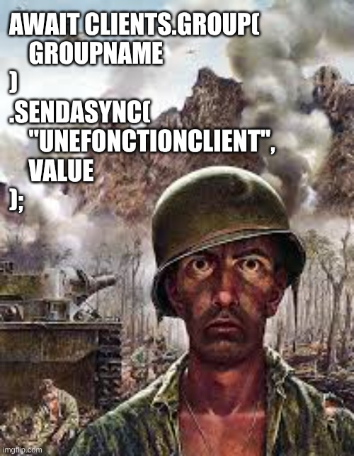

# Cloud Functions ☁️

## Pourquoi des Cloud Functions? 🤔

Dans le contexte du développement [serverless](./serverless.md), c'est possible de vouloir exécuter du code qui ne s'exécute pas directement sur votre client (ex : mobile, web), mais plutôt sur les serveurs du fournisseur de service serverless. Voici quelques raisons.

### Sécurité 🔒

Certains token d'API ne devraient pas se retrouver sur votre client, puisque nous avons déjà vu qu'[un secret sur un client n'est pas vraiment secret](../04-laboratoires/Laboratoire%208.2/l_antre_de_la_bete.md). On utilise donc la Cloud Function comme un [proxy](https://fr.wikipedia.org/wiki/Proxy) pour faire la requête, de sorte que votre token secret ne soit jamais visible pour les utilisateurs.

### Performance ⚡

Pour des requêtes de filtre avancées sur firestore, les options de base deviennent assez vite limitées. Certaines choses sont possible seulement par des Cloud Functions. 

### Contrôle centralisé 🎯

Au prochain cours, nous allons voir comment envoyer des notifications à l'aide de Cloud Functions. Si on prend l'exemple d'une application de messagerie de groupe, la meilleure pratique est d'avoir un serveur centralisé qui reçoit un message, et qui le distribue ensuite aux autres utilisateurs concernés. 

Comme dans votre [cours de Web Avancé](https://info.cegepmontpetit.ca/5W5-Web-Avancee/info/SignalR).



## Ajouter Cloud Functions à votre projet 🆕

Ajoutez la dépendance [cloud_functions](https://pub.dev/packages/cloud_functions) à votre projet.

Exécutez la commande `firebase init functions`, et approuvez tous les choix par défaut, à l'exception du choix du language, choisissez **TypeScript**. Le fichier `firebase.json` devrait avoir du code qui ressemble à ça, à la racine du json : 


```json
"functions": [
    {
      "source": "functions",
      "codebase": "default",
      "disallowLegacyRuntimeConfig": true,
      "ignore": [
        "node_modules",
        ".git",
        "firebase-debug.log",
        "firebase-debug.*.log",
        "*.local"
      ],
      "predeploy": [
        "npm --prefix \"$RESOURCE_DIR\" run lint",
        "npm --prefix \"$RESOURCE_DIR\" run build"
      ]
    }
  ]
```

Prenez le temps de regarder le contenu du répertoire `functions` qui vient d'être créé. C'est un peu comme un projet web, avec un `package.json` et un répertoire `src` qui va contenir les `functions`. Une description sommaire du rôle de chaque fichier / dossier est disponible [ici](https://firebase.google.com/docs/functions/typescript?hl=fr#initializing_a_new_project_with_typescript).

C'est aussi un bon moment pour configurer l'[émulateur de Cloud Functions](./emulateurs_firebase.md#function-emulator-).

:::note À faire maintenant, et à chaque fois que vous clonerez votre projet
Dans un terminal, dans le répertoire `functions`, exécutez `npm install`.

Typescript est un langage qui nécessite d'être compilé. À chaque fois que vous démarrez l'émulateur des Cloud Functions, vous devrez exécuter cette commande à partir du répertoire `functions` afin de surveiller les changements dans `functions/src` et les compiler automatiquement en Javascript, dans `functions/lib`.

```bash
npm run build:watch
```
:::

## Ma première fonction 👶
